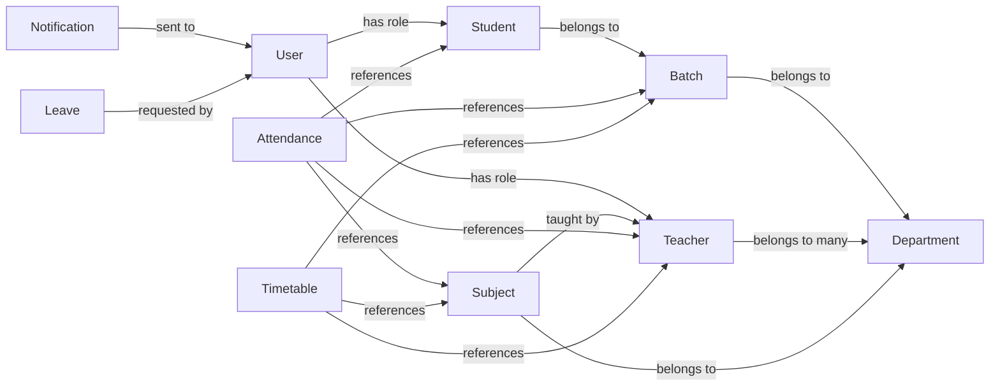

# Database Documentation

This document outlines the MongoDB schema definitions used by the College ERP backend.

---

## Models

### 1. `User`
| Field | Type | Required | Unique | Default | Validation |
|-------|------|----------|--------|---------|------------|
| `name` | String | Yes | No | – | – |
| `email` | String | Yes | Yes | – | lower‑cased, trimmed |
| `password` | String | Yes | No | – | – |
| `role` | String (enum) | Yes | No | – | One of `HOD`, `TEACHER`, `STUDENT` |
| `department` | String | No | No | – | – |
| `phone` | String | No | No | – | – |
| `avatar` | String | No | No | `""` | – |
| `avatarPublicId` | String | No | No | `""` | – |
| `isActive` | Boolean | No | No | `true` | – |
| `resetPasswordToken` | String | No | No | `null` | – |
| `resetPasswordExpires` | Date | No | No | `null` | – |
| Timestamps | `createdAt`, `updatedAt` | – | – | – | – |

### 2. `Student`
| Field | Type | Required | Unique | Default | Validation |
|-------|------|----------|--------|---------|------------|
| `studentName` | String | Yes | No | – | – |
| `registerNo` | String | Yes | Yes | – | – |
| `email` | String | Yes | Yes | – | – |
| `password` | String | Yes | No | – | – |
| `phoneNo` | String | No | No | – | – |
| `apaarId` | String | No | No | – | – |
| `aadhaarEncrypted` | String | No | No | – | – |
| `avatar` | String | No | No | `""` | – |
| `batchId` | ObjectId → **Batch** | Yes | No | – | – |
| `department` | String | No | No | `"Computer Science"` | – |
| `role` | String | No | No | `"STUDENT"` | – |
| `isFirstLogin` | Boolean | No | No | `true` | – |
| `isActive` | Boolean | No | No | `true` | – |
| Timestamps | `createdAt`, `updatedAt` | – | – | – | – |

### 3. `Teacher`
| Field | Type | Required | Unique | Default | Validation |
|-------|------|----------|--------|---------|------------|
| `teacherName` | String | Yes | No | – | – |
| `employeeId` | String | Yes | Yes | – | – |
| `email` | String | Yes | Yes | – | lowercase, trimmed |
| `password` | String | Yes | No | – | – |
| `phoneNo` | String | No | No | – | – |
| `avatar` | String | No | No | `""` | – |
| `departments` | [ObjectId → **Department**] | No | – | – | – |
| `role` | String | No | No | `"TEACHER"` | – |
| `isActive` | Boolean | No | No | `true` | – |
| Timestamps | `createdAt`, `updatedAt` | – | – | – | – |

### 4. `Batch`
| Field | Type | Required | Unique | Default | Validation |
|-------|------|----------|--------|---------|------------|
| `batchName` | String | Yes | Yes | – | trimmed |
| `program` | String | No | No | `"BCA"` | trimmed |
| `department` | String | Yes | No | – | trimmed |
| `admissionYear` | Number | No | No | `2024` | – |
| `currentSemester` | Number | No | No | `1` | min 1, max 8 |
| `startYear` | Number | Yes | No | – | – |
| `endYear` | Number | Yes | No | – | – |
| `isActive` | Boolean | No | No | `true` | – |
| Timestamps | `createdAt`, `updatedAt` | – | – | – | – |

### 5. `Department`
| Field | Type | Required | Unique | Default | Validation |
|-------|------|----------|--------|---------|------------|
| `departmentName` | String | Yes | Yes | – | trimmed |
| `departmentCode` | String | Yes | Yes | – | uppercase, trimmed |
| `hodName` | String | Yes | No | – | trimmed |
| `isActive` | Boolean | No | No | `true` | – |
| Timestamps | `createdAt`, `updatedAt` | – | – | – | – |

### 6. `Subject`
| Field | Type | Required | Unique | Default | Validation |
|-------|------|----------|--------|---------|------------|
| `subjectName` | String | Yes | No | – | trimmed |
| `subjectCode` | String | Yes | Yes | – | uppercase, trimmed |
| `departments` | [ObjectId → **Department**] | No | – | – | – |
| `teachers` | [ObjectId → **Teacher**] | No | – | – | – |
| `semester` | Number | Yes | No | – | min 1, max 6 |
| `credits` | Number | No | No | `4` | – |
| `isActive` | Boolean | No | No | `true` | – |
| Timestamps | `createdAt`, `updatedAt` | – | – | – | – |

### 7. `Attendance`
| Field | Type | Required | Unique Index |
|-------|------|----------|--------------|
| `student` | ObjectId → **Student** | Yes | Part of compound unique index |
| `subject` | ObjectId → **Subject** | Yes | Part of compound unique index |
| `teacher` | ObjectId → **Teacher** | Yes | – |
| `batch` | ObjectId → **Batch** | Yes | Part of compound unique index |
| `date` | Date | No (defaults to `Date.now`) | Part of compound unique index |
| `status` | String (enum: `Present`, `Absent`, `Late`) | Yes | – |
| Timestamps | `createdAt`, `updatedAt` | – | – |

**Compound unique index** on `{ student, subject, batch, date }` prevents duplicate attendance records for the same student/subject/batch on a given day.

---

## Relationships Overview

---

*All schemas are defined in `backend/models/*.js`. Indexes are created via Mongoose definitions (see `Attendance.js`).*